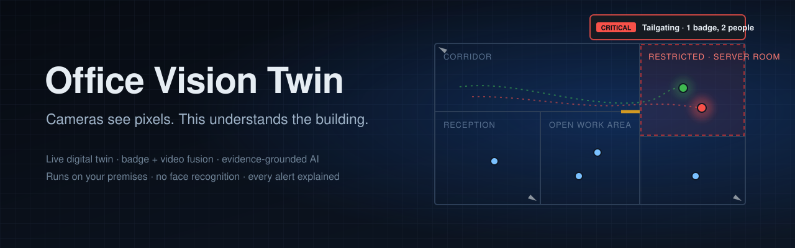
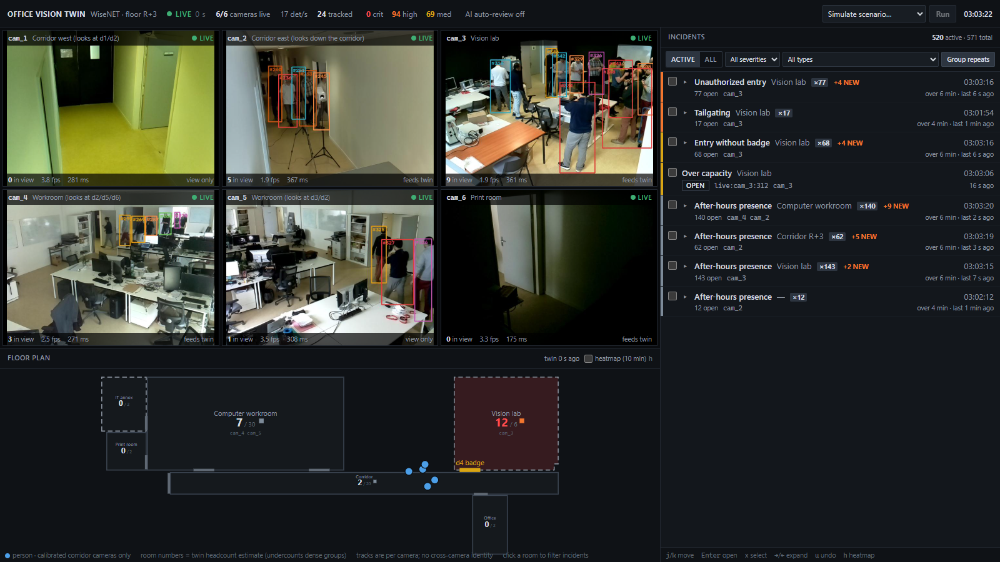
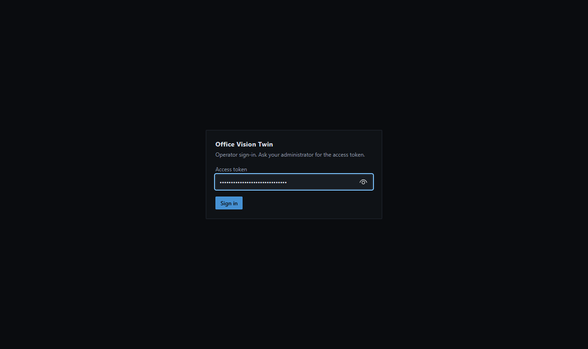
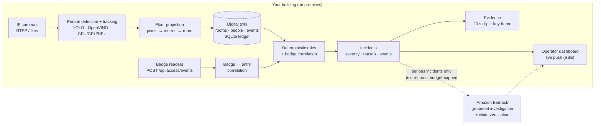

<p align="center">
  
</p>

<p align="center">
  <b>A live digital twin of your building that turns cameras and badge readers into explained, evidence-backed security incidents.</b><br>
  On-premises vision · deterministic rules · AI investigation that has to cite its evidence
</p>

<p align="center">
  
  
  
  
  
  
</p>

---

## Why this exists

A typical security operations room has dozens of camera feeds and one or two people watching them.
Human attention does not scale to a wall of screens: the moment that matters is easy to miss, and is
usually found only afterwards, by scrubbing through hours of recordings. Meanwhile the badge system knows
*who* opened a door and the cameras know *how many* walked through, but no one connects the two.

Most "AI camera" products add **person detection**: a box around everyone, and an alert when a box
appears in a region. That moves the problem rather than solving it. The operator now has a
thousand alerts a day and still has to work out what each one means.

**Office Vision Twin does the thinking an operator would do.** It keeps a live model of the building
(rooms, doors, who is where, who badged in) and reports *situations*, each with its reason and proof attached:

> **Tailgating · Server room · CRITICAL**
> Badge `0042` (granted 18:02:11) opened door D4. **Two** people entered within 3.1 s.
> Evidence: 20 s clip, key frame, 7 linked events. AI review: *"Second person not covered by any badge;
> recommend checking the server room now."* (every statement cites an event ID, and those IDs are checked.)

## What makes it different

| | Typical person-detection / VMS analytics | **Office Vision Twin** |
|---|---|---|
| Unit of output | A bounding box on a video frame | A person **on the floor plan**, in a room, over time |
| Understands the building | Lines and polygons drawn on each camera image | A **digital twin**: rooms, doors, security levels, capacities, business hours |
| Access control | Separate system, separate screen | **Fused**: badge swipe ↔ video entry, which finds tailgating, badge-without-entry and impossible transit |
| Alerts | "Motion / person in zone" | Explained incidents with **severity, reason, linked events and video evidence** |
| AI | Black-box classifier, or a chatbot that may make things up | **Grounded investigation**: the model may only use the incident's records, must cite IDs, and a second check rejects unsupported claims |
| AI cost control | Not applicable or unbounded | Hard **daily budget**, rate limits, de-duplication; about $0.01 per investigation |
| Privacy | Often face recognition / biometric watchlists | **No face recognition, no biometric templates.** Positions and counts, not identities |
| Where video goes | Frequently a vendor cloud | Video **stays on premises**. AI review (optional) receives text event records only |
| Real-time path | Often cloud-dependent | Fully **local**; cloud AI is never in the frame-by-frame loop |
| Verifiability | Vendor-reported accuracy | Measured on a real 6-camera building; numbers below and in `docs/` |

## Who it is for

- **Corporate offices and banks**: tailgating into secure floors, after-hours presence, server and vault rooms, visitor areas.
- **Government and critical facilities**: restricted-zone enforcement with an auditable event ledger and an operator in control of every decision.
- **Data centres and labs**: badge-to-person correlation at controlled doors.
- **Security integrators**: a reference architecture for fusing video analytics, access control and LLM-assisted triage safely.

## See it

| Operator dashboard | Sign-in (token-protected) |
|---|---|
|  |  |

Camera wall · live floor plan with people and room counts · incident queue with severity, status and bulk triage ·
incident detail with evidence clip, linked events and AI review. Keyboard-driven (`j`/`k`, `Enter`, `x`, `u`).

## How it works



**Design rules that keep it trustworthy**

1. **Determinism first.** Incidents come from explicit, testable rules over the twin's state, not from a model's opinion.
2. **AI explains and never decides.** The language model sees one incident's evidence packet, must cite event IDs for every claim,
   and a second pass rejects claims that are not supported. Operators close incidents; the AI does not.
3. **Never queue video.** Each camera processes only its newest frame, so delay cannot build up. Slow cameras skip frames and report it.
4. **Honest screens.** Every picture shows its age; stale data is flagged; nothing is shown as live when it is not.

## Incidents it detects

| Incident | Meaning |
|---|---|
| `UNAUTHORIZED_ENTRY` | Someone entered a restricted room without being on its authorized list |
| `TAILGATING` | More people entered through a badge door than badges were granted |
| `BADGE_WITHOUT_ENTRY` | A badge was granted but nobody came through (shared or cloned card?) |
| `AFTER_HOURS_BREACH` | Presence outside the building's business hours |
| `ZONE_OVER_CAPACITY` | A room exceeded its safe occupancy |
| `DWELL_ANOMALY` | Unusually long presence in a sensitive room |
| `TRACK_DISCONTINUITY` | A physically impossible move (teleport, or transit faster than the floor allows) |

## Quick start (about 5 minutes)

**Needs:** Python 3.11+, Node.js 20+. Works on Windows, macOS and Linux. No GPU and no cloud account are required.

```bash
git clone https://github.com/dhruvindave007/office-security-digital-twin-poc.git
cd office-security-digital-twin-poc
python scripts/setup.py          # installs everything, builds the dashboard, generates your access token
python scripts/start.py          # http://127.0.0.1:8000
```

Sign in with the token that `setup.py` printed (it is also in `backend/.env`). Then pick a scenario
in **Simulate scenario…** at the top right (for example `tailgating`) and press **Run** to watch an incident arrive.

Add cameras: `python scripts/setup.py --vision`, then follow **[Connect your cameras](docs/USER_MANUAL.md#4-connect-your-cameras)**.

## Documentation

| Guide | For |
|---|---|
| **[User manual](docs/USER_MANUAL.md)** | Install, sign in, work incidents, model your building, connect cameras and badge readers, enable AI |
| **[Security & deployment](SECURITY.md)** | Security model, hardening checklist for regulated environments, reporting vulnerabilities |
| [Operator dashboard](docs/DASHBOARD.md) | Every panel and shortcut in detail |
| [Live operation](docs/LIVE_OPERATION.md) | The camera pipeline and its measured performance |
| [Hands-on training](docs/HANDS_ON_TRAINING.md) | Eight exercises to learn the system by operating it |
| [Architecture](docs/ARCHITECTURE.md) | Component design and Bedrock integration contracts |
| [Third-party notices](THIRD_PARTY_NOTICES.md) | Licences of models, datasets and libraries; **read before commercial use** |

## Measured, not claimed

Measured on one laptop (Intel Core Ultra 7, no NVIDIA GPU) with a real 6-camera office building (WiseNET dataset):

| | Result |
|---|---|
| Cameras live at once | 6 at 5 fps each (30 detections/s total), integrated GPU + NPU |
| Frame → twin latency | p50 67–90 ms, p95 95–121 ms per camera; 20-min soak p95 ≤ 160 ms |
| Twin update | 2.2 ms per frame (p95 6 ms) |
| Detection vs 20,725 hand-labelled boxes | precision 0.848, recall 0.721 (YOLO11s) |
| Camera outage | all streams killed → shown as `reconnecting` → all back within 20 s, no restart |
| Tailgating on live video | ~13 alerts per loop vs 13 real followers; the badge holder admitted without an alarm |
| AI investigation | about $0.01 each; 0 unsupported claims with prompt v2; fabricated IDs caught by verification |

Details and caveats: [docs/LIVE_OPERATION.md](docs/LIVE_OPERATION.md) and [docs/evals/](docs/evals/).

## Security at a glance

- Every API route, the live push channel, camera pictures and evidence video require authentication (token or HttpOnly session cookie).
- With no token configured, the server answers **only the local machine**; `start.py` refuses to expose it on a network without one.
- Rate-limited sign-in, strict Content-Security-Policy, clickjacking and MIME-sniffing protection, request size caps, no stack traces to clients.
- No client-controlled file paths or stream URLs; YAML loaded safely; parameterized SQL; argument-list subprocesses (no shell).
- AWS credentials come only from the standard provider chain (SSO or instance role). Nothing secret lives in the repository.

See **[SECURITY.md](SECURITY.md)** for the full model and the checklist for bank and government deployments.

## Status and honest limits

This is a **pilot-ready proof of concept**, not a certified product. Before production in a regulated environment, read
[SECURITY.md › Production readiness](SECURITY.md#production-readiness-for-regulated-environments). In short:

- **Licences:** the default detector (Ultralytics YOLO) is **AGPL-3.0**. Commercial deployment needs an Ultralytics Enterprise licence or a
  swap to a permissively licensed detector (the tracker is behind an interface for this reason). The WiseNET and MOT17 datasets are
  **non-commercial**; they are not in this repository and are used only for internal validation.
- **Single access token** (no per-user accounts, roles or SSO yet); put it behind your identity-aware proxy for named-user auditing.
- **Single node, SQLite.** No high availability yet.
- **No cross-camera re-identification:** people are tracked per camera; one camera per room feeds the room counts.
- Tested on recorded footage replayed live, including over RTSP; not yet on a production camera network.

## Repository layout

```
backend/    FastAPI service: twin, rules, vision, live cameras, AI investigation (Python)
frontend/   Operator dashboard (React + TypeScript + Vite), served by the backend
data/       Demo building, rules, badge doors, scenarios; data/sites/<site>/ for real sites
scripts/    setup.py, start.py, demo.py (6-camera demo), RTSP replay, end-to-end checks
docs/       Manuals, measurements, evaluations, architecture
```

<sub>Built with FastAPI, React, Ultralytics YOLO, OpenVINO and Amazon Bedrock. WiseNET dataset: Marroquin et al., CC BY-NC-SA 4.0.</sub>
