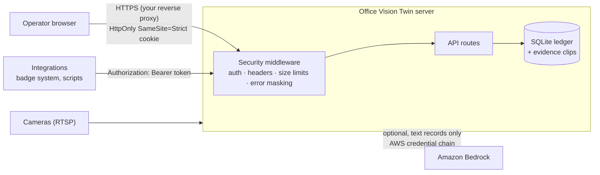

# Security

Office Vision Twin handles camera images, building layouts and access-control records, all of them
sensitive. This document describes how it protects them, what you must do when deploying it, and what is
not built yet.

## Reporting a vulnerability

Do **not** open a public issue. Email the maintainer (repository owner) with the details and steps to reproduce.
You will get an acknowledgement within 3 working days.

## Security model

| Control | Implementation |
|---|---|
| Authentication on everything | One middleware (`backend/src/api/security.py`) guards every `/api/*` route, the live push channel, camera pictures, evidence video and the API docs. New routes are protected automatically. |
| Safe default | With no `OVT_API_TOKEN`, only loopback (the same machine) is answered. `scripts/start.py` refuses a non-loopback `HOST` without a token. |
| Token handling | Minimum 24 characters (setup generates 256-bit tokens). Compared in constant time. The session cookie holds an HMAC of the token, never the token. `HttpOnly`, `SameSite=Strict`, `Secure` when `COOKIE_SECURE=true`. Rotating the token signs everyone out. |
| Brute force | 10 failed sign-ins per address within 5 minutes locks that address out; failures are logged. |
| Browser hardening | Strict Content-Security-Policy (`script-src 'self'`, `frame-ancestors 'none'`), `X-Frame-Options: DENY`, `nosniff`, `Referrer-Policy: no-referrer`, `Permissions-Policy`, HSTS over HTTPS. |
| Input safety | Request bodies capped at 1 MB; all query parameters bounded; identifiers checked against strict patterns; file paths resolved and confined to their directory; no client-chosen file paths or stream URLs; `yaml.safe_load` only; parameterized SQL only; subprocesses run with argument lists (never a shell). |
| Error masking | `DEBUG=false` by default; unexpected errors return a generic message, with details in the server log only. |
| Secrets | None in the repository. AWS access uses the standard credential chain (SSO, instance role). Camera passwords in RTSP URLs are masked in camera status output. `backend/.env` is git-ignored (and created owner-only on macOS/Linux). |
| AI safety | The model receives one incident's text records (no video), may only use that evidence, and must cite record IDs; a second pass rejects unsupported claims and invalid IDs. A hard daily budget, rate limits and de-duplication bound cost; investigations run one at a time so the budget cannot be overshot. The AI never changes incident state. |
| Availability | Cameras never queue frames; reconnect with backoff; MJPEG streams capped; evidence storage has a disk quota. |
| Verification | `backend/tests/unit/test_security.py` tests every control above; an adversarial review (2026-10-27) found one SSRF/file-probing route and three robustness issues. All four are fixed and covered by tests. |

## Deployment checklist

1. `python scripts/setup.py` generates a strong token in `backend/.env`. Share it only with operators, through your secrets manager.
2. Keep `HOST=127.0.0.1` and put a reverse proxy (nginx, IIS, an ALB, or your zero-trust gateway) in front, terminating **TLS**. Set `COOKIE_SECURE=true`.
3. Restrict network access to the operator VLAN or VPN. Cameras belong on their own isolated VLAN; only this server should reach them.
4. Run the service as a dedicated, unprivileged account. Give it read access to the repository and write access only to `backend/data/`.
5. Encrypt the disk that holds `backend/data/` (BitLocker, LUKS); it contains the event ledger and evidence video.
6. Set evidence retention (`EVIDENCE_MAX_TOTAL_MB`) and a database backup schedule that match your policy.
7. Rotate `OVT_API_TOKEN` when an operator leaves, and on a regular schedule.
8. For AI investigation, use a dedicated AWS role allowed only `bedrock:InvokeModel` / `Converse` on the chosen model, in your approved region.

## Production readiness for regulated environments

Banks, government agencies and critical-infrastructure operators will need the following before production use.
This list is deliberately explicit: these items are **not built yet**.

| Requirement | Status | Path |
|---|---|---|
| Named-user sign-in (SSO / SAML / OIDC, MFA) | ❌ one shared token | Deploy behind an identity-aware proxy now (e.g. Entra ID App Proxy, AWS Verified Access, oauth2-proxy); native OIDC is the next security milestone |
| Role-based access (viewer / operator / admin) | ❌ | Planned with OIDC |
| Per-user audit trail of operator actions | ⚠️ the event ledger records what happened, not who changed an incident's status | Planned with OIDC |
| High availability, multi-site | ❌ single node, SQLite | Postgres-backed store and stateless API workers |
| FIPS 140-validated cryptography | ⚠️ depends on the OS and Python build | Run on a FIPS-enabled OS image; TLS at a FIPS-validated proxy |
| Certifications (SOC 2, ISO 27001, FedRAMP, CJIS) | ❌ | These certify an operating organisation and its controls, not just code |
| Commercial licence for the detector | ⚠️ AGPL-3.0 | See [THIRD_PARTY_NOTICES.md](THIRD_PARTY_NOTICES.md) |
| Privacy impact assessment / works-council approval | Required by you | No face recognition or biometric templates, which simplifies GDPR / BIPA / CCPA analysis but does not replace it |
| Penetration test by an independent party | ❌ | Recommended before production |

## Supported versions

Security fixes go to the latest commit on `master`.
