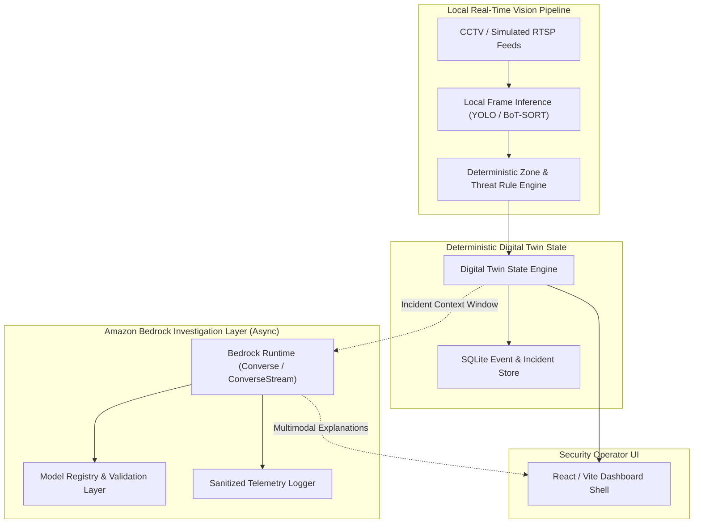

# Office Vision Intelligence Platform — Canonical Architecture Specification
**Version:** 1.1 (Frozen Baseline + M1 Review Patches)  
**Status:** Approved & Frozen  

---

## 1. System Overview & Core Tenets

The Office Vision Intelligence Platform is an AI-powered physical security and situational awareness platform built upon three foundation pillars:
1. **Local Real-Time Vision Pipeline:** Edge-tier camera feeds and local inference (YOLO / BoT-SORT) for deterministic person detection, tracking, and zone intrusion detection. Real-time vision processing must remain local and low-latency.
2. **Deterministic Digital Twin:** Authoritative real-time state store maintaining office zones, cameras, people coordinates, incident lifecycles, and event history. Cloud AI is never placed on the frame-by-frame control loop.
3. **Amazon Bedrock Investigation Layer:** Asynchronous multimodal reasoning invoked selectively for incident investigation, cross-camera person tracking narratives, and conversational security operator inquiries (Ask Camera, Investigate Incident, Daily Summaries).

---

## 2. Milestone 1 Architecture Patches (v1.3 Final Review Patch)

### Fix A — Dynamic Model Registry Layer (`backend/src/ai/model_registry.py`)
- Decomposes model management into:
  - `StaticModelCatalog`: Canonical baseline configurations for known foundation models (`us.amazon.nova-lite-v1:0`, `us.amazon.nova-pro-v1:0`, `us.amazon.nova-micro-v1:0`, `us.anthropic.claude-3-5-sonnet-20241022-v2:0`, `amazon.titan-text-express-v1`).
  - `DynamicValidator`: Validates model identifier syntax (including cross-region inference profiles and full Bedrock ARNs), queries AWS control-plane metadata when permissions are present, and falls back safely to static definitions on access denial or offline mode.
  - `VerifiedModelCapabilities`: In-memory cache holding validated capability flags (`supports_converse`, `supports_streaming`, `supports_tools`, `supports_multimodal`, `supports_video`, `max_context_tokens`, `source`).

### Fix B — Structured Telemetry Logging (`backend/src/core/logging.py`)
- Emits sanitized operational JSON metadata to logger `office_vision.bedrock`:
  - `event`: `"bedrock_invocation"`
  - `request_id`, `model_id`, `latency_ms`, `streamed`, `retry_count`, `status`, and `error_type`.
- **Absolute Prohibition:** Never logs prompts, system instructions, completion text, HTTP headers, credentials, or secrets.

### Fix C — Startup Readiness Validation (`backend/src/main.py` & `backend/src/api/routes_system.py`)
- Startup readiness probing runs during FastAPI's lifespan startup context manager without executing billable inferences:
  - Validates boto3 import and version.
  - Inspects standard AWS credential provider chain (`client.is_credentialed()`).
  - Validates and caches configured reasoning model capabilities.
- Exposes non-billable readiness state via `GET /api/system/bedrock`.

### Fix D — Canonical `TokenUsage` Schema (`backend/src/ai/types.py`)
- Standardized, immutable token accounting across sync and streaming invocations:
  - `input_tokens: int = 0`
  - `output_tokens: int = 0`
  - `total_tokens: int = 0`
  - `cache_read_tokens: Optional[int] = None`
  - `cache_write_tokens: Optional[int] = None`

---

## 3. Bedrock API Contracts & Boundaries

1. **API Protocol:** Amazon Bedrock Runtime Converse API (`converse`) and ConverseStream API (`converse_stream`). Legacy `InvokeModel` raw JSON schemas are prohibited.
2. **Retry Strategy:** Boto3 built-in adaptive retry mode (`retries={"max_attempts": 3, "mode": "adaptive"}`) with socket timeouts (`connect_timeout=10.0`, `read_timeout=60.0`). Redundant external retry loops are prohibited.
3. **Mid-Stream Error Handling:** Event stream consumers must inspect dictionary payloads for mid-stream error envelopes (`throttlingException`, `internalServerException`, etc.) and raise `BedrockStreamError`.
4. **Credential Chain:** Relies strictly on AWS standard credential provider chain (environment variables, AWS SSO, instance profiles, or `~/.aws/credentials`). Hardcoding credentials or committing `.env` files with secrets is strictly forbidden.
